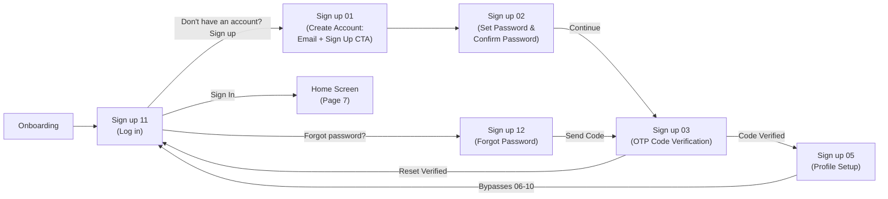

# AdStreet App — Screen Implementation & Status Ledger

This document maintains a live record of all mobile screens from `AdStreet - Mobile App Screens 11112026.pdf`, tracking which screens are active, temporarily commented out, or pending.

---

## 1. Splash & Onboarding (Page 2)

| Screen ID | PDF Page | Component / View | Status | Notes |
| :--- | :--- | :--- | :--- | :--- |
| **Splash 01** | Page 2 | `SplashScreenView.tsx` | ✅ **Active** | Luxury gradient presentation (`#5B161B` ➔ `#E22029`) |
| **Splash 02** | Page 2 | `SplashScreenView.tsx` | ✅ **Active** | 3D ruby diamond emblem entrance with 2s loading (0-100%), loader removal, 500ms forward lift & 1.5s 3D Y-axis spin |
| **Splash ➔ Onboarding** | Page 2 | Seamless Merging Layer | ✅ **Active** | 60fps Reanimated matched-coordinate backdrop fade & in-place 3D spin revealing Onboarding radar hub |
| **Onboarding** | Page 2 | `OnboardingScreenView.tsx` | ✅ **Active** | Full-screen horizontal paging with native Reanimated concentric radar circles & staggered entrance |

---

## 2. Authentication & Sign Up (Pages 3–6)

| Screen ID | Step | Component / View | Status | Flow Routing Notes |
| :--- | :---: | :--- | :---: | :--- |
| **Sign up 01** | Step 1 | `SignUp01View.tsx` | ✅ **Active** | **Create an account** (Email address input, Sign Up CTA directly below, divider `or`, Social buttons, link to Log in) |
| **Sign up 02** | Step 2 | `SignUp02View.tsx` | ✅ **Active** | **Create a password** (Dedicated screen just like Forgot Password: Password, Confirm Password, eye toggles, Continue CTA) |
| **Sign up 03** | Step 3 | `SignUp03View.tsx` | ✅ **Active** | Split 6-digit OTP verification code (Active in **Create Account** after entering password, and in **Forgot Password** recovery) |
| **Sign up 04** | Step 4 | `SignUp04View.tsx` | ⏸️ **Commented Out** | **Role Selection** (Individual, Company, Guru cards). Bypassed by user request. |
| **Sign up 05** | Step 5 | `SignUp05View.tsx` | ✅ **Active** | **Set up your profile** (Fixed circular avatar placeholder with camera upload, Phone number, Email address, Gradient Red Continue CTA). |
| **Sign up 06** | Step 6 | `SignUp06View.tsx` | ⏸️ **Commented Out** | **Choose your services/skills** (Category, skills tag box, starting price stepper). Bypassed by user request. |
| **Sign up 07** | Step 7 | `SignUp07View.tsx` | ⏸️ **Commented Out** | **Upload your portfolio (Empty State)**. Bypassed by user request. |
| **Sign up 08** | Step 8 | `UploadPortfolioModal.tsx` | ⏸️ **Commented Out** | **Upload Portfolio Modal** (Sample thumbnails, camera add, caption, upload CTA). Bypassed by user request. |
| **Sign up 09** | Step 9 | `SignUp09View.tsx` | ⏸️ **Commented Out** | **Upload your portfolio (Populated State)**. Bypassed by user request. |
| **Sign up 10** | Step 10 | `SignUp10View.tsx` | ⏸️ **Commented Out** | **Language selection** (English, Urdu, Arabic RTL banner). Bypassed by user request. |
| **Sign up 11** | Step 11 | `SignUp11View.tsx` | ✅ **Active** | **Log in** (Email prefill, password, eye toggle, forgot password, social buttons). Advanced to directly from Step 5. |
| **Sign up 12** | Step 12 | `SignUp12View.tsx` | ✅ **Active** | **Forgot Password** (Email input, Send Code CTA). |

---

## 3. Current Live Active Signup Flow

---

## 4. Home Screen & Navigation (Page 7)

| Screen ID | PDF Page | Component / View | Status | Notes |
| :--- | :---: | :--- | :---: | :--- |
| **Home Screen** | Page 7 | `HomeScreenView.tsx` | ✅ **Active** | Deep crimson gradient header, AdStreet brand badge, coin tracker (15), region selector (Karachi, PK), hero headline carousel, 6 category cards (AdBazaar, AdLeaks, AdBooks, AdMeet, AdGuru, AdRead), floating `<GlassSurface>` tab bar. |

### Commented Out / Consolidated Screens Summary:
1. **Sign up 02 (Password setup)**:
   - File: `src/features/auth/SignUp02View.tsx`
   - Consolidated into Step 01 (Create account) to match the Login screen layout.
2. **Sign up 04 (Role Selection)**:
   - File: `src/features/auth/SignUp04View.tsx`
   - Bypassed in `SignUpFlow.tsx`: Step 3 (OTP) jumps directly forward to Step 5 (Profile Setup). Step 5 back returns directly to Step 3.
3. **Sign up 06 (Choose your services/skills)**:
   - File: `src/features/auth/SignUp06View.tsx`
   - Bypassed in `SignUpFlow.tsx`: Step 5 (Profile Setup) jumps directly forward to Step 11 (Log in).
4. **Sign up 07 (Upload your portfolio - Empty State)**:
   - File: `src/features/auth/SignUp07View.tsx`
   - Bypassed per user request.
5. **Sign up 08 (Upload portfolio modal)**:
   - File: `src/features/auth/UploadPortfolioModal.tsx` / `SignUp08View.tsx`
   - Bypassed per user request.
6. **Sign up 09 (Upload your portfolio - Populated State)**:
   - File: `src/features/auth/SignUp09View.tsx`
   - Bypassed per user request.
7. **Sign up 10 (Language selection)**:
   - File: `src/features/auth/SignUp10View.tsx`
   - Bypassed per user request.
